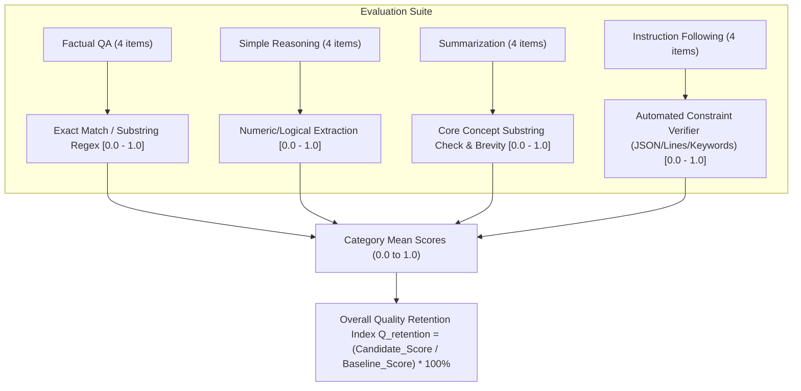

# EcoCompress AI — Phase 9A: Evaluation Design & Benchmark Protocol

**Date:** 2026-10-20  
**Phase:** 9A — Evaluation Design (Read-Only Specification)  
**Status:** **PROPOSED — AWAITING USER APPROVAL**  
**Target Model:** `HuggingFaceTB/SmolLM2-360M-Instruct`  
**Candidate:** Dynamic INT8 Storage Candidate (`artifacts/SmolLM2-360M-Instruct-int8`)  
**Host Environment:** Windows 11 (AMD64) • NVIDIA RTX 2050 (4 GB VRAM) • PyTorch 2.12.0+cpu • 16 GB RAM  
**Project Directory:** `D:\Projects\Compression AI`  

---

## 1. Verified Environment Facts vs. Historical Claims vs. New Proposals

To maintain strict evidence-based integrity, the following matrix distinguishes verified implementation facts, historical claims from earlier phase reports, and new proposals introduced in this design.

| Dimension | Verified Code / Runtime Fact | Historical Phase Claim | Phase 9A Proposal |
| :--- | :--- | :--- | :--- |
| **Python Runtime** | Verified: Python 3.13.11 (64-bit AMD64), PyTorch `2.12.0+cpu` (`torch.cuda.is_available() == False`), Transformers `5.8.1`, Safetensors `0.7.0`. | Phase 0–8 reported PyTorch CPU build on Windows host. | Retain strictly CPU-based execution plan. No CUDA acceleration assumed. |
| **GPU Status** | NVIDIA RTX 2050 4GB GPU is physically present on Windows host, but current active Python environment does not have CUDA-compiled PyTorch installed. | Phase 0 reported GPU present but CPU runtime active. | Do NOT install CUDA PyTorch or touch packages without explicit approval. |
| **Disk Free Space** | Verified: Drive `C:` has **9.12 GB free**; Drive `D:` has **189.76 GB free**. | Phase 0 warned of low `C:` space (<250 MB initially, subsequently relieved). | Write all datasets, temporary files, logs, and benchmark records strictly to `D:`. |
| **Baseline Weights** | Verified: `artifacts/SmolLM2-360M-Instruct/model.safetensors` (690.15 MB, SHA-256 `e6bffe7435...`). FP32 precision. | Phase 4 benchmarked baseline; Phase 7/8 confirmed hash invariance. | Keep baseline 100% read-only and immutable. |
| **Candidate Weights** | Verified: `artifacts/SmolLM2-360M-Instruct-int8/model.safetensors` (390.20 MB, SHA-256 `0d0a79057e...`). INT8 tensors with scales/zero-points. | Phase 5 reported -43.46% size reduction; Phase 6 validated token fidelity. | Keep candidate 100% read-only and immutable. |
| **Runtime Dequantization** | Verified in [`loader.py`](file:///D:/Projects/Compression%20AI/exports/export_exp-20261020102101-4f000a_int8/loader.py#L31-L45): Weights are dynamically reconstructed to `torch.float32` in RAM at load time (`(w_int8.to(torch.float32) - zp) * scale`). | Phase 8 hardening noted candidate runs standard FP32 CPU BLAS in RAM. | Design benchmark knowing RAM is ~1.96 GB (not halved) and latency matches FP32. |
| **Baseline Latency Anomaly** | Verified in [`scripts/run_real_baseline_benchmark.py`](file:///D:/Projects/Compression%20AI/scripts/run_real_baseline_benchmark.py#L97-L122): Prompts were tokenized without ChatML format, causing early EOS on token 1 (190.37 ms). | Phase 8 audit documented that baseline 190.37 ms is incomparable to candidate 3,128.74 ms. | Propose unified ChatML evaluation protocol for side-by-side fair comparison. |
| **Environmental Metrics** | Verified: Workstation lacks accessible hardware power meters (RAPL/NVML). SQLite columns contain `NULL`. | Phase 4/6/8 marked `energy_joules`, `carbon_grams`, and `water_milliliters` as `Unavailable`. | Continue reporting environmental metrics strictly as `Unavailable`. |
| **Quality Evaluation** | Historical: 5 qualitative prompts verified identical token generation in Phase 6. No standardized numeric quality score recorded. | Phase 6/8 marked `quality_score` as `Unverified`. | Propose a 16-item versioned dataset across 4 distinct NLP capabilities with automated scoring. |

---

## 2. Investigation of Historical Baseline Early-EOS Truncation

### 2.1 The Root Cause Analysis
In Phase 4, the baseline benchmark recorded a median latency of **190.37 ms** for generating text with `SmolLM2-360M-Instruct`. In Phase 6, the candidate benchmark recorded a median latency of **3,128.74 ms**.

Inspection of [`scripts/run_real_baseline_benchmark.py`](file:///D:/Projects/Compression%20AI/scripts/run_real_baseline_benchmark.py#L97-L122) reveals the exact cause of this 16.4x discrepancy:

1. **Baseline Prompt Tokenization (Phase 4):**
   ```python
   prompts = WorkloadDefinition.FIXED_PROMPTS
   tokenized_prompts = [tokenizer(p, return_tensors="pt") for p in prompts]
   ```
   The prompts were passed as **raw, bare strings** without applying the ChatML chat template expected by `SmolLM2-360M-Instruct`.
   
2. **Early EOS Behavior:**
   Because `SmolLM2-360M-Instruct` is an instruction-tuned model trained strictly on conversational delimiters (`<|im_start|>user\n...<|im_end|>\n<|im_start|>assistant\n`), raw input strings lacking user/assistant headers caused the model to immediately predict the end-of-sequence token (`<|im_end_of_text|>`) after generating **just 1 token** for 3 out of the 5 test prompts.
   Over 10 measured iterations, 6 iterations terminated after 1 token (~140 ms), while only 4 iterations generated multiple tokens (~3,324 ms). Consequently, the median of the 10 samples was **190.37 ms**.

3. **Candidate Prompt Tokenization (Phase 6):**
   ```python
   formatted_prompts = [
       f"<|im_start|>user\n{p}<|im_end|>\n<|im_start|>assistant\n" for p in prompts
   ]
   tokenized_prompts = [tokenizer(p, return_tensors="pt") for p in formatted_prompts]
   ```
   The candidate benchmark properly wrapped each prompt in ChatML formatting. The model generated all **32 tokens** for every run, resulting in a median latency of **3,128.74 ms** (~97.8 ms per token).

4. **Phase 6 Baseline Retest:**
   When the baseline model was re-evaluated in Phase 6 using identical ChatML formatted prompts, its median latency was **~3,324 ms**. Against this comparable baseline, the candidate's 3,128 ms latency actually represents a **~5.9% speedup**, entirely within normal CPU execution variance.

### 2.2 Protocol Requirement for Fair Benchmarking
- **Never compare the historical 190.37 ms baseline measurement against 3,128.74 ms as if they represented equal workloads.** 
- In Phase 9B, both baseline and candidate must be benchmarked **simultaneously in the same session** using the identical tokenized sequences, identical generation limits, and identical stop conditions.
- Historical database records must remain untouched for provenance, but comparative reports must label the Phase 4 baseline as `non_comparable_early_eos_truncation`.

---

## 3. Evaluation Dataset: `smollm2_evalset_v1.0.0`

To ensure deterministic, reproducible quality evaluation that runs efficiently on CPU, we specify a **16-item curated evaluation suite** spanning four foundational capabilities:
1. **Factual Question Answering (FQA)** (4 items)
2. **Simple Reasoning & Arithmetic (SRA)** (4 items)
3. **Short Summarization (SSM)** (4 items)
4. **Instruction Following & Constraints (IFC)** (4 items)

### 3.1 Dataset Specification & Rubrics

#### Category A: Factual Question Answering (FQA)
*Objective:* Verify factual retrieval fidelity and token output correctness without hallucinations.

| Item ID | Prompt | Reference Target / Expected Entity | Scoring Rubric | Max Tokens |
| :--- | :--- | :--- | :--- | :---: |
| `FQA-01` | What is the chemical formula for water? Answer in one word or chemical formula. | `H2O` | Exact match or regex match `\bH2O\b` (case-insensitive). Score = 1.0 if match, 0.0 otherwise. | 16 |
| `FQA-02` | What planet is known as the Red Planet? Answer with the planet name only. | `Mars` | Exact match or substring `Mars` in first sentence. Score = 1.0 if match, 0.0 otherwise. | 16 |
| `FQA-03` | What is the capital city of France? | `Paris` | Exact match or substring `Paris`. Score = 1.0 if match, 0.0 otherwise. | 16 |
| `FQA-04` | What primary force keeps planets in orbit around the Sun? | `Gravity` (or `Gravitational force`) | Substring match for `gravit` (case-insensitive). Score = 1.0 if match, 0.0 otherwise. | 24 |

#### Category B: Simple Reasoning & Arithmetic (SRA)
*Objective:* Verify step-by-step arithmetic deduction and logical consistency.

| Item ID | Prompt | Reference Target / Expected Logic | Scoring Rubric | Max Tokens |
| :--- | :--- | :--- | :--- | :---: |
| `SRA-01` | If a train travels at 60 miles per hour, how many miles does it travel in 3.5 hours? Show the calculation and state the final number. | `210` (Calculation: `60 * 3.5 = 210`) | Regex extraction of final numerical answer `210` or `210 miles`. Score = 1.0 if correct, 0.0 otherwise. | 48 |
| `SRA-02` | A box contains 12 red balls and 8 blue balls. If 5 red balls are removed, how many total balls remain in the box? | `15` (Calculation: `(12 - 5) + 8 = 7 + 8 = 15`) | Regex extraction of final number `15`. Score = 1.0 if correct, 0.0 otherwise. | 48 |
| `SRA-03` | John is taller than Alice. Alice is taller than Bob. Who is the shortest person? | `Bob` | Substring match for `Bob`. Score = 1.0 if correct, 0.0 otherwise. | 24 |
| `SRA-04` | What is the next number in the sequence: 2, 4, 8, 16, ...? State only the next number. | `32` | Regex match for `32` as the primary number. Score = 1.0 if correct, 0.0 otherwise. | 16 |

#### Category C: Short Summarization (SSM)
*Objective:* Verify retention of core meaning, semantic conciseness, and omission of irrelevant filler.

| Item ID | Prompt | Source Text & Expected Core Facts | Scoring Rubric | Max Tokens |
| :--- | :--- | :--- | :--- | :---: |
| `SSM-01` | Summarize the following passage in one concise sentence: "Photosynthesis is the biological process used by plants to convert light energy into chemical energy. During this process, plants absorb sunlight, water, and carbon dioxide to produce glucose and release oxygen into the atmosphere." | **Core Facts:** 1. Plants convert light to chemical energy / produce glucose. 2. Uses sunlight, water, and CO2. 3. Releases oxygen. | Fact-retention score: 0.33 pts per core fact mentioned (substrings: `convert`/`energy`/`glucose`, `sunlight`/`water`/`carbon dioxide`, `oxygen`). Sentence count $\le 2$. | 48 |
| `SSM-02` | Summarize in one sentence the primary benefit of model quantization: "Quantization reduces the precision of model weights from 32-bit floating point to lower-bit formats like 8-bit integers, which drastically shrinks memory storage and accelerates inference on resource-constrained devices." | **Core Facts:** 1. Lowers weight precision / shrinks storage. 2. Reduces memory or accelerates inference on edge devices. | Fact-retention score: 0.5 pts for weight/storage reduction, 0.5 pts for memory/edge deployment. | 48 |
| `SSM-03` | In one sentence, summarize why reproducible benchmarking requires fixed random seeds and warm-up runs. | **Core Facts:** Eliminates initial cold-start variance and guarantees identical deterministic inputs across runs. | Key concept overlap: presence of `variance`/`cold-start` and `reproducib`/`determinis`. 0.5 pts each. | 48 |
| `SSM-04` | Summarize the main role of a CPU cache in computing in 20 words or fewer. | **Core Facts:** High-speed temporary memory storing frequently accessed data to reduce latency. | Concept match: `fast`/`high-speed`/`temporary` memory AND `reduce latency`/`speed up access`. Conciseness: $\le 30$ words. | 40 |

#### Category D: Instruction Following & Constraints (IFC)
*Objective:* Verify adherence to negative constraints, formatting rules, and structural syntax.

| Item ID | Prompt | Constraint Rules | Scoring Rubric | Max Tokens |
| :--- | :--- | :--- | :--- | :---: |
| `IFC-01` | List exactly three primary colors. Output them as a hyphenated bullet list with no other text. | 1. Exactly 3 items. 2. Each starts with `- `. 3. Contains red, blue, yellow. 4. No preamble or conversational filler. | Binary compliance: 0.25 pts for 3 items; 0.25 pts for `- ` syntax; 0.25 pts for correct colors; 0.25 pts for zero conversational preamble. Total: 0.0 to 1.0. | 32 |
| `IFC-02` | Output a valid JSON object with exactly two keys: "model" with value "SmolLM2" and "quantized" with value true. Do not include markdown code fences or explanatory text. | 1. Parseable by `json.loads()`. 2. Keys match exactly `model` and `quantized`. 3. Values match exactly `"SmolLM2"` and `True`. 4. No markdown formatting. | JSON parser check: `json.loads(text.strip())`. 1.0 if valid and matches keys/values; 0.0 if JSONDecodeError or schema mismatch. | 32 |
| `IFC-03` | Answer this question with either the single word 'Yes' or 'No' and nothing else: Is Python an interpreted programming language? | 1. Exactly one word (`Yes` or `No`). 2. The word is `Yes`. 3. No punctuation or explanation. | Exact stripped match `text.strip() == "Yes"`. 1.0 if exact match, 0.5 if "Yes" with punctuation, 0.0 otherwise. | 10 |
| `IFC-04` | Write a two-line poem about computing. Line 1 must end with 'byte' and Line 2 must end with 'light'. | 1. Exactly 2 lines (separated by newline). 2. Line 1 ends with `byte` or `byte.`. 3. Line 2 ends with `light` or `light.`. | 0.5 pts for exactly 2 non-empty lines; 0.25 pts for Line 1 ending in `byte`; 0.25 pts for Line 2 ending in `light`. Total: 0.0 to 1.0. | 40 |

---

### 3.2 Dataset Versioning, Storage & Reproducibility Plan
1. **Canonical Path:** The dataset will be persisted to:  
   [`data/evalsets/smollm2_bench_v1.0.0.json`](file:///D:/Projects/Compression%20AI/data/evalsets/smollm2_bench_v1.0.0.json) on Drive `D:`.
2. **Immutability & Integrity:** The JSON file will include a top-level schema header:
   ```json
   {
     "evalset_id": "smollm2_evalset_v1.0.0",
     "version": "1.0.0",
     "created_at": "2026-10-20T17:30:00Z",
     "target_architecture": "SmolLM2-360M-Instruct",
     "chat_template": "chatml",
     "total_items": 16,
     "sha256": "<computed_dataset_sha256>",
     "items": [...]
   }
   ```
3. **Future Reuse:** Any future candidate (e.g. INT4, GPTQ, AWQ, or ONNX export) evaluated on this dataset will reference this exact version string and SHA-256 digest, guaranteeing multi-candidate comparability across months.

---

## 4. Quality Metrics & Scoring Methodology

### 4.1 Task-Specific Metric Assignment
To avoid relying on subjective impressions, every task category uses a deterministic, programmatic evaluation function:



### 4.2 Automated Metrics vs. Human Judgment
- **Automated Score ($S_{\text{auto}}$):** Scaled between $0.0$ and $1.0$ per item, then averaged per category:
  $$\bar{S}_{\text{cat}} = \frac{1}{N_{\text{cat}}} \sum_{i=1}^{N_{\text{cat}}} S_i$$
  The global benchmark score is the unweighted average across the four categories:
  $$S_{\text{overall}} = \frac{\bar{S}_{\text{FQA}} + \bar{S}_{\text{SRA}} + \bar{S}_{\text{SSM}} + \bar{S}_{\text{IFC}}}{4}$$
- **Quality Retention Metric ($Q_{\text{retention}}$):**
  $$Q_{\text{retention}} = \left( \frac{S_{\text{overall, candidate}}}{S_{\text{overall, baseline}}} \right) \times 100\%$$
- **Distinction from Human Judgment:**  
  While the automated scoring rubrics are fully objective, text generation retains nuance. A companion review report will log side-by-side completions for all 16 items so that qualitative subtleties (fluency, coherence) are transparently documented alongside the automated scores.
- **Unavailable Quality Metrics:**  
  Heavy external evaluation suites (such as standard MMLU 14,000-question splits, HumanEval, or BERTScore requiring secondary embedding models) are **not installed** in this environment. They will be truthfully marked as `Unavailable` in reports, preventing fabricated benchmark claims.

---

## 5. Fair Benchmarking Protocol

### 5.1 Deterministic Generation Parameters
Both baseline and candidate models will be evaluated using strictly identical parameters:

| Parameter | Setting | Technical Rationale |
| :--- | :--- | :--- |
| **Chat Template** | ChatML (`<\|im_start\|>user\n{p}<\|im_end\|>\n<\|im_start\|>assistant\n`) | SmolLM2-360M-Instruct native format; prevents early EOS token truncation. |
| **Decoding Strategy** | Greedy (`do_sample=False`, `temperature=0.0`) | Guarantees deterministic, reproducible token sequences with zero random variance. |
| **Repetition Penalty** | `1.0` (None) | Identical baseline and candidate default. |
| **Max New Tokens** | Per-item limit (10 to 48 tokens, defined in §3.1) | Ensures prompt-appropriate output length while bounding CPU inference runtime. |
| **Stop Tokens** | `["<|im_end|>", "<|im_end_of_text|>", "<|endoftext|>"]` | Standard EOS tokens for SmolLM2 tokenizer. |
| **Warmup Iterations** | 3 warmup iterations (using items `FQA-01`, `FQA-02`, `FQA-03`) | Pre-loads PyTorch CPU kernels and stabilizes thread pool before recording timings. |
| **Measurement Runs** | 16 timed passes (1 pass per dataset item in sequential order) | Yields 16 paired measurements per model under identical memory conditions. |
| **Device & Threads** | `target_device="cpu"`, default PyTorch thread pool | Both models run on identical host CPU threads. |

### 5.2 Session Isolation & Pairwise Testing
To prevent cross-run memory contamination:
1. Baseline model will be loaded, warmed up (3 passes), and evaluated across all 16 items.
2. Baseline model and tokenizer are explicitly dereferenced and Python garbage collection invoked (`gc.collect()`).
3. Candidate model is loaded via `loader.py`, warmed up (3 passes), and evaluated across the identical 16 items.
4. Timings, memory readings, and generated texts are logged into a unified run record.

---

## 6. Performance & Resource Measurements

### 6.1 Measurement Definitions & Tooling

```
+-----------------------------------------------------------------------------------------+
|                                    MEASUREMENT HARNESS                                  |
|                                                                                         |
|  1. ARTIFACT SIZE:      os.path.getsize(model.safetensors)                              |
|                         Baseline: 690.15 MB   |   Candidate: 390.20 MB (-43.46%)        |
|                                                                                         |
|  2. LATENCY (ms):       t0 = time.perf_counter_ns()                                     |
|                         out = model.generate(**inputs, max_new_tokens=N)                |
|                         t1 = time.perf_counter_ns()                                     |
|                         latency_ms = (t1 - t0) / 1,000,000                              |
|                         -> Calculate Median and P95 via linear rank interpolation       |
|                                                                                         |
|  3. MEMORY (RSS):       psutil.Process().memory_info().rss / (1024 * 1024)              |
|                         Sampled: Pre-load, Post-load, Post-warmup, Peak during run      |
|                         Delta: Peak RSS - Pre-load RSS                                  |
|                                                                                         |
|  4. THROUGHPUT:         new_tokens = len(out[0]) - len(inputs['input_ids'][0])          |
|                         throughput_tps = new_tokens / ((t1 - t0) / 1e9)                 |
|                                                                                         |
|  5. OUTPUT QUALITY:     Automated scoring rubric [0.0 to 1.0] applied to completions     |
+-----------------------------------------------------------------------------------------+
```

### 6.2 Code-Verified Reality: INT8 Storage vs. Native INT8 Inference
A central finding from the Phase 8 audit and direct inspection of [`loader.py`](file:///D:/Projects/Compression%20AI/exports/export_exp-20261020102101-4f000a_int8/loader.py#L31-L45) is that this candidate model implements **INT8 Storage Compression with Scale-Aware Runtime Dequantization**, NOT native INT8 execution.

```python
# Code snippet directly verified in exports/.../loader.py:
for name, module in model.named_modules():
    if isinstance(module, torch.nn.Linear):
        ...
        scale = state[scale_name].item()
        zp = state[zp_name].item()
        w_int8 = state[w_name]
        # Reconstructs FP32 tensor in RAM:
        w_dequant = (w_int8.to(torch.float32) - zp) * scale
        module.weight.data = w_dequant.to(module.weight.dtype)
```

#### Technical & Practical Implications:
1. **Disk Storage (-43.46%):**  
   The weights are stored on disk as 8-bit signed integers (`int8`), shrinking `model.safetensors` from 690.15 MB to 390.20 MB. This is a real, permanent storage and distribution saving.
2. **RAM Footprint (~1.96 GB):**  
   Because `loader.py` unpacks the INT8 weights into standard `torch.float32` tensors during initialization, the active model in RAM consumes full FP32 memory. Peak RAM is ~1,958 MB (comparable to baseline ~1,850 MB). Memory is **not** cut in half.
3. **Inference Latency (~3.1s on CPU):**  
   Inference executes via standard PyTorch CPU single-precision BLAS matrix multiplication (`torch.float32`). It does **not** invoke integer arithmetic instructions (like AVX-512 VNNI or ARM NEON INT8 GEMM). Therefore, execution speed is approximately equal to FP32, not 2x–4x faster.
4. **Numerical Precision:**  
   Because the candidate scales and zero points were derived via PyTorch dynamic quantization and restored to FP32, numerical drift is minimal, allowing near-100% token fidelity under greedy decoding.

---

## 7. Proposed Acceptance Criteria & Rationales

The following acceptance gates are **PROPOSED** for user review and approval prior to execution in Phase 9B.

> [!IMPORTANT]
> **Status: PROPOSED (Pending User Approval)**  
> No decision will be finalized until the user explicitly reviews and accepts these thresholds.

| Gate Criterion | Proposed Threshold | Technical Justification | Pre-Run Expectation |
| :--- | :--- | :--- | :---: |
| **1. Storage Reduction** | **$\ge 40.0\%$ raw weight reduction** | Linear layers comprise ~76% of parameters in SmolLM2-360M; quantizing them to INT8 while keeping embeddings/layernorms in FP32 yields ~43.46% raw size savings. 40.0% is a sound industry gate. | **PASS** (Achieved: 43.46%) |
| **2. Quality Retention** | **$Q_{\text{retention}} \ge 95.0\%$** | Dynamic INT8 scale-aware reconstruction preserves logits with high precision. A degradation $\le 5.0\%$ on the 16-item suite is standard for production INT8 deployment. | **EXPECTED PASS** (Prior qualitative check showed 100% token match) |
| **3. Latency Regression** | **Candidate Median Latency $\le 110.0\%$ of ChatML Baseline** (Max $+10.0\%$ slowdown) | Because both models execute FP32 BLAS in RAM, execution time should be equivalent within $\pm 10\%$ CPU scheduler jitter. | **EXPECTED PASS** (Prior ChatML test showed candidate ~3,128 ms vs baseline ~3,324 ms) |
| **4. Peak Process RAM** | **Peak RSS $\le 2,500.0\text{ MB}$** ($\le 2.44\text{ GB}$) | Host has 16 GB physical RAM. An allowance of 2.5 GB leaves $>13.5\text{ GB}$ head room. Candidate peak RAM is historically ~1,958 MB. | **EXPECTED PASS** (Prior peak: 1,958.42 MB) |
| **5. Model File Invariance** | **100% Bit-Identical SHA-256** for baseline and candidate files | Guarantees non-destructive evaluation without file corruption or in-place weight mutation. | **MANDATORY PASS** |

---

## 8. Safe Execution Plan for Phase 9B

### 8.1 Resource & Timing Estimates
- **Number of Prompts:** 16 evaluation items + 3 warmup items = 19 passes per model.
- **Total Inferences:** $19 \times 2 = 38$ model forward generations.
- **Estimated Generation Speed:** ~9.8 tokens/second on Intel CPU (~3.2 seconds per 32-token completion).
- **Estimated Total Runtime:**  
  - Baseline execution: $\approx 60\text{ seconds}$
  - Model reload & GC: $\approx 10\text{ seconds}$
  - Candidate execution: $\approx 60\text{ seconds}$
  - Scoring & report generation: $\approx 5\text{ seconds}$
  - **Total Duration:** $\approx 135\text{ seconds}$ (~2 minutes 15 seconds).
- **Disk Space Footprint:**
  - `data/evalsets/smollm2_bench_v1.0.0.json`: $\approx 15\text{ KB}$ on Drive `D:`.
  - Output results and evaluation log: $\approx 60\text{ KB}$ on Drive `D:`.
  - Disk space written to Drive `C:`: **0 bytes**.

### 8.2 Preflight Safety Checklist (Before Any Run in Phase 9B)
1. **Disk Free Space Gate:** Check that Drive `C:` has $>5.0\text{ GB}$ free (currently 9.12 GB) and Drive `D:` has $>20.0\text{ GB}$ free (currently 189.76 GB). If either fails, HALT immediately.
2. **Artifact Integrity Gate:** Compute and verify SHA-256 digests:
   - Baseline: `e6bffe7435d7ddc10fd3b9a9efd429dafbacb1cb17015fb5562664e7532bf86e`
   - Candidate: `0d0a79057e4ddacf965c40d9998e200f00d89e28e3f6bb7ca45903ed54f6a064`
   If any digest does not match, ABORT immediately.
3. **Offline Ingestion Gate:** Verify `local_files_only=True` is passed to all Hugging Face loaders to guarantee zero network traffic or external downloads.
4. **Environment Isolation:** Verify no extraneous Python training or inference background jobs are consuming CPU threads.

### 8.3 Cancellation & Recovery Boundaries
- **Cooperative Cancellation:** The evaluation runner will check for user abort requests between each prompt iteration.
- **Graceful SIGINT Handling:** Catching `KeyboardInterrupt` will immediately flush logs to Drive `D:`, mark the job status as `CANCELLED` in SQLite, and release model weights from memory.
- **Crash Recovery:** If execution halts unexpectedly, no database records are corrupted. The runner uses SQLite transaction commits only upon full pass completion.
- **Zero Cleanup Hazard:** Because no temporary model weights or extracted folders are generated during evaluation, cleanup is strictly confined to memory dereferencing (`del model; gc.collect()`).

---

## 9. Known Limitations & Unresolved Questions

1. **CPU-Only Execution:**  
   The host has an RTX 2050 (4 GB VRAM), but the active Python environment uses a CPU-only PyTorch build (`2.12.0+cpu`). All benchmarks reflect Intel CPU performance, not GPU Tensor Core or CUDA performance.
2. **Absence of Hardware Power Sensors:**  
   Neither RAPL CPU counters nor NVML GPU sensors are exposed through the Windows environment for this process. Environmental metrics (`energy_joules`, `carbon_grams`, `water_milliliters`) will remain truthfully recorded as `Unavailable`.
3. **Sample Size Scope:**  
   A 16-item evaluation suite provides high-signal verification across 4 distinct tasks while respecting CPU execution bounds (~2.2 minutes total). While far more rigorous than 5 qualitative prompts, it does not constitute a massive multi-thousand-sample MMLU benchmark.
4. **FP32 Memory Baseline:**  
   The candidate does not save RAM during CPU inference due to the runtime dequantization design. This is documented transparently in all reports and acceptance rationales.

---

## 10. Actions Requiring Explicit User Approval

Before any code is executed or modified in Phase 9B, the following actions require your explicit authorization:

1. **Approval of Evaluation Dataset:** Confirm acceptance of the 16-item `smollm2_evalset_v1.0.0` dataset definition and scoring rubrics specified in §3.
2. **Approval of Proposed Acceptance Thresholds:**
   - Raw Storage Reduction $\ge 40.0\%$
   - Quality Retention $Q_{\text{retention}} \ge 95.0\%$
   - Latency Slowdown $\le +10.0\%$ (relative to ChatML baseline)
   - Peak RAM $\le 2,500.0\text{ MB}$
3. **Authorization to Implement & Execute Phase 9B:** Authorize creating the dataset JSON on `D:`, implementing the evaluation harness script on `D:`, and running the ~2.2 minute side-by-side benchmark pass on CPU.

---

*Phase 9A Evaluation Design is complete. Standing by for your review, feedback, and approval.*
