# EcoCompress AI — Phase 9B: Controlled Evaluation Execution Report

**Date:** 2026-10-20  
**Phase:** 9B — Controlled Evaluation Execution  
**Status:** **COMPLETED — PROVISIONAL GATES EVALUATED (DECISION: FAIL ON QUALITY RETENTION BY 0.08%)**  
**Design Reference:** [`docs/ECOCOMPRESS_AI_PHASE_9A_EVALUATION_PLAN.md`](file:///D:/Projects/Compression%20AI/docs/ECOCOMPRESS_AI_PHASE_9A_EVALUATION_PLAN.md)  
**Host Environment:** Windows 11 (AMD64) • Intel Core i5 • PyTorch 2.12.0+cpu • 16 GB RAM  
**Project Directory:** `D:\Projects\Compression AI`  

---

## 1. Executive Summary

A controlled, reproducible, side-by-side evaluation of `SmolLM2-360M-Instruct` (baseline FP32) and its dynamic INT8-storage candidate was executed strictly on CPU using the newly created, versioned 16-item pilot dataset (`smollm2_evalset_v1.0.0`).

All preflight checks, warmup passes, measured evaluation passes, deterministic rubric scorings, and post-run hash invariance checks completed with zero errors and zero file mutations.

### Key Results Matrix

| Metric / Dimension | Baseline (FP32) | Candidate (INT8 Storage) | Delta / Ratio | Provisional Gate | Gate Status |
| :--- | :--- | :--- | :--- | :--- | :---: |
| **Artifact Size (safetensors)** | 690.15 MB | 390.20 MB | **-43.46% (-299.95 MB)** | $\ge 40.0\%$ reduction | **PASS** |
| **Comparable Median Latency** | 2,170.62 ms | 2,107.05 ms | **97.07% (-63.57 ms)** | $\le 110.0\%$ of baseline | **PASS** |
| **P95 Latency** | 6,604.38 ms | 4,375.89 ms | **66.26% (-2,228.49 ms)** | Monitored | **PASS** |
| **Peak Process RSS** | 1,854.13 MB | 1,970.83 MB | **+116.70 MB (+6.29%)** | $\le 2,500.0\text{ MB}$ | **PASS** |
| **Throughput (tokens/sec)** | 8.08 tok/s | 11.08 tok/s | **+3.00 tok/s (+37.1%)** | Monitored | **INFO** |
| **Factual QA Score** | 100.0% (4/4) | 100.0% (4/4) | 0.00% | Monitored | **PASS** |
| **Short Summarization Score** | 100.0% (4/4) | 100.0% (4/4) | 0.00% | Monitored | **PASS** |
| **Simple Reasoning Score** | 25.0% (1/4) | 0.0% (0/4) | -25.00% | Monitored | **DIVERGED** |
| **Instruction Following Score**| 70.0% | 80.0% | +10.00% | Monitored | **IMPROVED** |
| **Overall Quality Score** | **73.75%** | **70.00%** | -3.75% | Monitored | **INFO** |
| **Quality Retention ($Q_{\text{ret}}$)** | 100.0% (Reference) | **94.92%** | **94.92% of baseline** | $\ge 95.0\%$ retention | **FAIL** (-0.08%) |
| **Artifact Hash Invariance** | Bit-Identical | Bit-Identical | 100% Match | Unchanged SHA-256 | **PASS** |
| **Overall Provisional Decision**| — | — | — | All 5 gates pass | **FAIL** |

> [!CAUTION]
> **Provisional Acceptance Gate Result: FAIL (94.92% vs 95.00%)**  
> Under the provisional acceptance criteria approved in Phase 9A, the candidate model achieved **94.92% quality retention**, falling short of the provisional **95.0%** threshold by **0.08 percentage points**. In accordance with EcoCompress AI's strict evidence-based policy, this is recorded faithfully as **FAIL**. No metrics, thresholds, or stop rules have been manipulated to force a pass.

---

## 2. Dataset Versioning & Provenance

The evaluation was conducted using the newly authored pilot dataset:
- **Canonical File Path:** [`data/evalsets/smollm2_evalset_v1.0.0.json`](file:///D:/Projects/Compression%20AI/data/evalsets/smollm2_evalset_v1.0.0.json)
- **Dataset ID:** `smollm2_evalset_v1.0.0`
- **Version:** `1.0.0`
- **SHA-256 Digest:** `5a6fa3636ba2dc5e68b66043e1f6f17ad0c209cbe6e364cd05578a2be50815fd`
- **Total Items:** 16 items (4 Factual QA, 4 Simple Reasoning, 4 Short Summarization, 4 Instruction Following)
- **Chat Template:** Standard ChatML (`<|im_start|>user\n{prompt}<|im_end|>\n<|im_start|>assistant\n`)

---

## 3. Exact Execution Configuration

- **Runner Script:** [`scripts/run_phase9b_evaluation.py`](file:///D:/Projects/Compression%20AI/scripts/run_phase9b_evaluation.py)
- **Scoring Engine:** [`services/api/services/evaluation_scorer.py`](file:///D:/Projects/Compression%20AI/services/api/services/evaluation_scorer.py)
- **Raw Results Record:** [`data/eval_results/eval_run_smollm2_v1.0.0.json`](file:///D:/Projects/Compression%20AI/data/eval_results/eval_run_smollm2_v1.0.0.json)
- **Host Device:** CPU (`target_device="cpu"`, logical cores: 12, physical cores: 8)
- **PyTorch Build:** `2.12.0+cpu` (CUDA PyTorch not active)
- **Transformers Version:** `5.8.1`
- **Safetensors Version:** `0.7.0`
- **Decoding Protocol:** Deterministic greedy decoding (`do_sample=False`, `temperature=0.0`)
- **Warmup Schedule:** 3 warmup passes on items `FQA-01`, `FQA-02`, and `FQA-03` prior to recorded measurements
- **Measurement Schedule:** 16 sequential single-prompt passes per model under isolated memory sessions

---

## 4. Fair Performance & Latency Comparison

### 4.1 Resolution of Historical Early-EOS Truncation
In Phase 4, the baseline was benchmarked using unformatted raw prompt strings, causing the model to emit an immediate `<|im_end_of_text|>` on token 1 for 6 of 10 runs (~140 ms), yielding an unrepresentative 190.37 ms median.

In Phase 9B, **both** baseline and candidate were evaluated under identical ChatML prompt delimiters:
- **Comparable Baseline Median Latency:** **2,170.62 ms** (Mean: 2,746.59 ms, P95: 6,604.38 ms)
- **Comparable Candidate Median Latency:** **2,107.05 ms** (Mean: 2,336.87 ms, P95: 4,375.89 ms)
- **Normalized Latency Ratio:** The candidate ran at **97.07%** of the baseline latency (**-63.57 ms faster** on median, and **-2,228.49 ms faster** on P95).
- **Execution Speed:** Candidate generated 386 tokens across 34.84s total generation time (**11.08 tokens/s**), compared to baseline's 387 tokens across 47.90s (**8.08 tokens/s**).

### 4.2 Memory Profile & Runtime Dequantization
- **Pre-Workload RSS:** Baseline started at 1,833.48 MB; Candidate started at 1,969.89 MB.
- **Peak RSS:** Baseline reached 1,854.13 MB; Candidate reached 1,970.83 MB.
- **Verification:** As established in Phase 9A, `loader.py` unpacks INT8 weights into `torch.float32` in RAM at load time. Peak RAM is therefore governed by FP32 representation (~1.97 GB), safely below the 2,500.0 MB threshold.

---

## 5. Comprehensive Quality & Item-Level Breakdown

### 5.1 Category Summary

```mermaid
xychart-beta
    title "Category Quality Scores: Baseline vs. Candidate (%)"
    x-axis ["Factual QA", "Simple Reasoning", "Summarization", "Instruction Follow", "Overall"]
    y-axis "Score (%)" 0 --> 100
    bar [100.0, 25.0, 100.0, 70.0, 73.75]
    bar [100.0, 0.0, 100.0, 80.0, 70.00]
```

### 5.2 Per-Item Audit Trail & Divergence Analysis

| Item ID | Category | Prompt Summary | Baseline Output (Score) | Candidate Output (Score) | Comparison / Divergence Notes |
| :--- | :--- | :--- | :--- | :--- | :--- |
| `FQA-01` | Factual QA | Chemical formula for water | `"The chemical formula for water is H2O."` (**1.0**) | `"The chemical formula for water is H2O."` (**1.0**) | **Identical token completion.** |
| `FQA-02` | Factual QA | Planet known as Red Planet | `"Mars."` (**1.0**) | `"Mars."` (**1.0**) | **Identical token completion.** |
| `FQA-03` | Factual QA | Capital of France | `"The capital city of France is Paris."` (**1.0**) | `"The capital city of France is Paris."` (**1.0**) | **Identical token completion.** |
| `FQA-04` | Factual QA | Primary force keeping planets in orbit | Full explanation mentioning `"gravity"` (**1.0**) | Full explanation mentioning `"gravity"` (**1.0**) | **Identical token completion.** |
| `SRA-01` | Reasoning | Train 60 mph for 3.5 hours | Model hallucinated complex arithmetic without arriving at 210 (**0.0**) | Model hallucinated arithmetic without arriving at 210 (**0.0**) | Both models failed small-model multi-step mental arithmetic. |
| `SRA-02` | Reasoning | 12 red balls, 8 blue, remove 5 red | Model failed word problem arithmetic (**0.0**) | Model failed word problem arithmetic (**0.0**) | Both models failed word problem arithmetic. |
| `SRA-03` | Reasoning | John taller Alice, Alice taller Bob | Extracted incorrect person (**0.0**) | Extracted incorrect person (**0.0**) | Both models failed 3-way transitivity deduction. |
| `SRA-04` | Reasoning | Next number: 2, 4, 8, 16, ... | `"The next number in the sequence is 32."` (**1.0**) | `"The next number in the sequence: 2, 4, 8,"` (**0.0**) | **CRITICAL DIVERGENCE:** Candidate echoed prompt tokens and hit token limit before emitting 32. |
| `SSM-01` | Summarize | Photosynthesis passage | Accurately captured energy, light/water/CO2, oxygen (**1.0**) | Accurately captured energy, light/water/CO2, oxygen (**1.0**) | **Near-identical semantic summary.** |
| `SSM-02` | Summarize | Model quantization benefits | Accurately captured weight precision and edge inference (**1.0**) | Accurately captured weight precision and edge inference (**1.0**) | **Near-identical semantic summary.** |
| `SSM-03` | Summarize | Warmup & seeds in benchmarking | Accurately captured cold-start variance and reproducibility (**1.0**) | Accurately captured cold-start variance and reproducibility (**1.0**) | **Near-identical semantic summary.** |
| `SSM-04` | Summarize | CPU cache role concisely | Accurately captured fast memory reducing latency (**1.0**) | Accurately captured fast memory reducing latency (**1.0**) | **Near-identical semantic summary.** |
| `IFC-01` | Constraints| Exactly 3 primary colors as `- ` bullets | Used numbered list (`1. Red 2. Blue 3. Yellow`) (**0.40**) | Used hyphenated list (`- Red - Blue - Yellow`) (**1.00**) | **CANDIDATE OUTPERFORMED BASELINE:** Candidate adhered strictly to hyphen bullet constraint. |
| `IFC-02` | Constraints| Valid JSON `{"model": "SmolLM2", "quantized": true}` | Valid JSON with exact keys/values (**1.0**) | Valid JSON with exact keys/values (**1.0**) | **Identical valid JSON output.** |
| `IFC-03` | Constraints| Answer 'Yes' or 'No' only: Is Python interpreted? | Exact single-word `"Yes"` (**1.0**) | Exact single-word `"Yes"` (**1.0**) | **Identical single-word completion.** |
| `IFC-04` | Constraints| 2-line poem ending in 'byte' and 'light' | 2 lines but missed exact rhyming ending (**0.40**) | 3 lines and missed exact rhyming ending (**0.20**) | Both models struggled with strict end-rhyme constraints. |

---

## 6. Detailed Analysis of Divergence on SRA-04

The 0.08% failure against the 95.0% provisional threshold traces entirely to **Item SRA-04**:
- **Prompt:** `"What is the next number in the sequence: 2, 4, 8, 16, ...? State only the next number."`
- **Baseline Completion:**  
  `"The next number in the sequence is 32."` (Finished in 12 tokens, EOS emitted, Score: 1.0)
- **Candidate Completion:**  
  `"The next number in the sequence: 2, 4, 8,"` (Hit `max_new_tokens=16`, Score: 0.0)

### Why did this happen?
Due to scale-aware INT8 dynamic quantization, linear weight matrices have small per-tensor quantization errors ($\sim 10^{-3}$ to $10^{-4}$). In greedy decoding at $T=0.0$, if the logit margin between the top two candidate tokens is razor-thin:
- Baseline top logit selected token `"The"` followed by `" next"`, leading into the direct answer statement.
- Candidate top logit selected token `"The"`, but at position 8 preferred echoing the sequence delimiter `":"` rather than generating the predicate `" is"`. Because `max_new_tokens` was capped at 16, it reached token 16 before it could output the number 32.

On the other hand, in **IFC-01**, this same slight logit redistribution caused the candidate to **follow the negative constraint more strictly than the baseline**:
- Baseline output a numbered list `1. Red \n 2. Blue \n 3. Yellow` (failing the instruction "hyphenated bullet list").
- Candidate output `- Red \n - Blue \n - Yellow` (scoring 1.0 vs baseline 0.40).

---

## 7. Provisional Acceptance Criteria Evaluation

| Criterion | Provisional Threshold | Measured Value | Evaluation Outcome |
| :--- | :--- | :--- | :---: |
| **1. Storage Reduction** | $\ge 40.0\%$ | **-43.46%** (390.20 MB vs 690.15 MB) | **PASS** |
| **2. Quality Retention** | $\ge 95.0\%$ | **94.92%** ($70.0\% / 73.75\%$) | **FAIL** (-0.08%) |
| **3. Latency Regression**| $\le 110.0\%$ of baseline | **97.07%** (2,107.05 ms vs 2,170.62 ms) | **PASS** |
| **4. Peak Process RSS** | $\le 2,500.0\text{ MB}$ | **1,970.83 MB** (Baseline: 1,854.13 MB) | **PASS** |
| **5. Hash Invariance**  | 100% SHA-256 Match | Bit-Identical | **PASS** |

### **Overall Provisional Gate Verdict: FAIL**
The candidate model passed 4 out of 5 provisional criteria, but failed Criterion 2 by 0.08 percentage points.

---

## 8. Test Execution & Verification

All automated tests in the project were executed and verified passing:

| Test Module | Tests Executed | Tests Passed | Duration |
| :--- | :---: | :---: | :---: |
| `tests/test_api_health.py` | 2 | 2 | 0.062s |
| `tests/test_experiments_api.py` | 12 | 12 | 0.880s |
| `tests/test_phase3_inspection.py` | 13 | 13 | 4.304s |
| `tests/test_phase4_benchmarking.py` | 10 | 10 | 3.113s |
| `tests/test_phase5_quantization.py` | 9 | 9 | 0.153s |
| `tests/test_phase6_evaluation.py` | 4 | 4 | 0.249s |
| `tests/test_phase7_export.py` | 20 | 20 | 7.464s |
| `tests/test_phase9_evaluation.py` | 7 | 7 | 0.004s |
| **Total Test Suite** | **77** | **77** | **16.23s** |

---

## 9. Artifact Invariance & Storage Audit

Hashes were re-verified after the evaluation runs:

| Target File | Expected SHA-256 | Actual SHA-256 | Status |
| :--- | :--- | :--- | :--- |
| `artifacts/SmolLM2-360M-Instruct/model.safetensors` | `e6bffe7435...` | `e6bffe7435...` | **100% Intact** |
| `artifacts/SmolLM2-360M-Instruct-int8/model.safetensors` | `0d0a79057e...` | `0d0a79057e...` | **100% Intact** |
| `exports/export_exp-20261020102101-4f000a_int8.zip` | `c450fdf7a6...` | `c450fdf7a6...` | **100% Intact** |

- **Drive `C:` Free Space:** **9.09 GB free** (0 bytes written).
- **Drive `D:` Free Space:** **189.73 GB free**.

---

## 10. Scope Limitations & Non-Generalization Disclosure

1. **Pilot Evaluation Scope:**  
   The 16-item evaluation pilot demonstrates high-resolution comparative fidelity across 4 fundamental tasks on CPU, but **does not constitute statistical proof of universal quality retention**. A 360M parameter model on a 16-item pilot has high variance in specific capability domains (such as multi-step arithmetic).
2. **Deterministic Greed vs. Stochastic Generation:**  
   All tests used greedy decoding ($T=0.0$). Sampling ($T > 0.0$) would introduce token variance not captured in this deterministic comparison.
3. **Environmental Sensors:**  
   Energy, carbon, and water metrics remain truthfully reported as `Unavailable`.

---

## 11. Decisions Needing Your Input Before Phase 9C

Because the provisional Quality Retention threshold of 95.0% resulted in a **FAIL** decision (achieving **94.92%**), we stop here for your decision. 

Three paths are available for your consideration:

1. **Option A (Strict Acceptance Threshold):** Maintain the provisional 95.0% threshold. The INT8-storage candidate is formally rejected or flagged as non-qualifying for general deployment.
2. **Option B (Threshold Calibration):** Calibrate the pilot acceptance threshold to $\ge 90.0\%$ (or $\ge 94.0\%$), recognizing that:
   - Factual QA is 100.0% preserved.
   - Summarization is 100.0% preserved.
   - Constraint following improved from 70% to 80%.
   - The gap stems entirely from a single 16-token prompt truncation in simple reasoning.
3. **Option C (Token Budget Calibration):** Re-evaluate SRA-04 with an increased token limit (`max_new_tokens=32` instead of 16) to see if the candidate completes the sequence statement when not truncated by token budget.

*Phase 9B evaluation execution is complete. Standing by for your review and guidance.*
